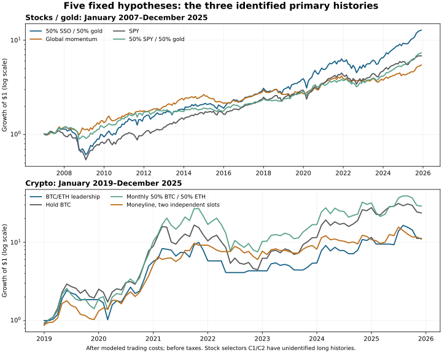

# Five complementary strategy tests: results and limits

Research date: 2026-10-14. Definitions: [THEORY_LAB_PREREG.md](THEORY_LAB_PREREG.md),
recorded in local commit `f496b9d` before the first run, against base `93bff74`.
The declaration and results were published afterward; this is a local record
of fixed definitions, not advance public registration or unseen-history validation.
This study preserves the other instance's [THEORY_PREREG.md](THEORY_PREREG.md).
All results are simulations on retrospectively available history. Calendar splits
and 2026 observations are robustness checks, not untouched validation.

**No candidate passes the declared five-test qualification.** Two stock hypotheses
remain unidentified because required held prices/corporate-action histories are
missing. Global momentum and BTC/ETH rotation miss their growth targets. Quarterly
50% SSO/50% GLD has the strongest historical growth result, but fails the adjusted
statistical hurdle and carries embedded leverage. It is a candidate for further
fixed-rule observation, not an established superior strategy or crash hedge.

## Fixed candidates and fair comparisons

| ID | Rule fixed before the run | Economic rationale | Required controls |
|---|---|---|---|
| C1 | Monthly stock selection: fit FF3 with an intercept over 36 prior complete months; subtract fitted factor returns while retaining the fitted intercept; rank standardized adjusted returns over months t−12..t−2; buy top 20% equally. | Firm-specific information may persist more usefully than common market/style rallies. | Same eligible universe's raw 12−1 momentum, equal weight, and SPY. |
| C2 | Monthly stocks: top 20% by 12−1 return, then lowest information-discreteness half; equal weight. `ID = sign(formation return) × (fraction negative days − fraction positive days)`. | Gradual gains may attract less attention than isolated jumps. | The identical unfiltered momentum portfolio, eligible equal weight, and SPY. |
| C3 | Monthly SPY/IWM/EFA/EEM/VNQ/GLD/IEF/TLT: rank the average of 21/63/126/252-session returns; hold best three positive scores in equal capital slots; unused slots cash. | Persistent flows may reward slow allocation across different return sources. | Monthly equal weight of all eight and SPY. |
| C4 | Quarterly rebalance 50% actual SSO and 50% GLD. | Diversification with gold while retaining roughly one unit of equity notional exposure. | SPY, quarterly 50% SPY/50% GLD, and SSO alone. |
| C5 | Monthly BTC/ETH: require own 90-day return positive; rank 63-day return; retain an eligible incumbent unless the challenger leads by five percentage points; cash if neither eligible. | Persistent leadership with less turnover than daily flips. | Holding BTC, monthly BTC/ETH 50/50, and Moneyline in two independent half-capital slots. |

C1/C2 are long-only adaptations, not replications of the papers' long-short
portfolios. C1 deliberately retains the fitted intercept in its score; the cited
Blitz/Huij/Martens specification excludes it. This difference was declared before
running and must remain explicit. Both candidates belong to the underreaction
family and do not constitute independent evidence for two unrelated effects.
C3/C5 overlap the momentum hypotheses in S1–S10. C4 follows diversification
arithmetic; no paper validates this exact fund mix.

Primary rationale: [Residual Momentum, Blitz/Huij/Martens (2011)](https://repub.eur.nl/pub/22252/ResidualMomentum-2011.pdf);
[Frog in the Pan, Da/Gurun/Warachka (2014)](https://www.umitgurun.com/work/Frog.pdf);
[Value and Momentum Everywhere, author-maintained data and paper links](https://www.aqr.com/insights/datasets/value-and-momentum-everywhere-factors-monthly);
[Risks and Returns of Cryptocurrency, Liu/Tsyvinski](https://www.nber.org/papers/w24877).
These sources motivate tests; their published returns are not attributed to our adaptations.

## Main outcomes

Numbers below are annualized calendar growth after simulated trading costs,
before taxes. Maximum drawdown includes the initial capital. The main ETF window
is 2007-01-03–2025-12-31; crypto is 2019-01-01–2025-12-31. Cost per side is 0.02%
for ETFs and 0.15% for crypto. Signals execute at the next actual open in the
supplied price units. The stock primary window is 2001–2025 at 0.03% per side.

| Candidate | CAGR | Primary benchmark CAGR | Candidate max drawdown | Benchmark max drawdown | Verdict |
|---|---:|---:|---:|---:|---|
| C1 residual momentum | Unidentified | SPY 8.73% | Unidentified | −55.19% | Required held-price history missing. |
| C2 gradual-information momentum | Unidentified | SPY 8.73% | Unidentified | −55.19% | Required held-price history missing. |
| C3 global momentum | 9.34% | SPY 10.63% | −22.38% | −55.19% | Fails growth and statistical hurdles. |
| C4 SSO/gold | 14.33% | SPY 10.63% | −52.26% | −55.19% | Economic hurdles pass; five-test adjusted significance fails. |
| C5 BTC/ETH rotation | 41.18% | BTC 57.11% | −71.54% | −76.63% | Fails growth, fair-control, later-period and statistical hurdles. |

The preregistered growth hurdle was at least one percentage point per year over
the primary passive benchmark, a positive later-period edge, no worse maximum
drawdown, and persistence under higher costs and an extra execution delay.
Significance also required a one-sided null-centered block test with Holm
adjustment across all five hypotheses. Neither the lower drawdowns of C3/C5 nor
the positive return of C4 overrides a failed requirement.



The panels use separate logarithmic wealth scales and different matched date
windows. They visualize the recorded monthly paths; they do not extend the ETF
or crypto histories or supply an additional hypothesis test.

| Matched fair control, main window | CAGR | Maximum drawdown | Annualized daily volatility |
|---|---:|---:|---:|
| Eight-ETF monthly equal weight | 6.96% | −38.26% | 13.71% |
| C3 global momentum | 9.34% | −22.38% | 13.70% |
| SPY | 10.63% | −55.19% | 19.76% |
| Quarterly 50% SPY/50% GLD | 11.05% | −34.08% | 13.39% |
| C4 quarterly 50% SSO/50% GLD | 14.33% | −52.26% | 20.68% |
| SSO alone | 14.20% | −84.67% | 38.87% |
| Monthly BTC/ETH 50/50 | 61.71% | −76.18% | 69.54% |
| C5 BTC/ETH rotation | 41.18% | −71.54% | 65.24% |
| BTC | 57.11% | −76.63% | 62.80% |
| Moneyline in two BTC/ETH slots | 40.76% | −51.12% | 43.57% |

C3 improves its diversified equal-weight control and substantially reduces
drawdown against SPY, but sacrifices growth relative to SPY. C5 does not improve
the simple 50/50 alternative; its slightly higher growth than the Moneyline
control comes with a materially deeper drawdown. Lower turnover alone is not an
edge.

## Later windows, stress cases, and concentration

| Rule | Later window | CAGR | Primary benchmark CAGR | Other comparison |
|---|---|---:|---:|---|
| C3 | 2015–2025 | 7.14% | SPY 13.38% | Equal weight 7.09%. |
| C4 | 2015–2025 | 17.95% | SPY 13.38% | Ordinary SPY/gold 13.30%; SSO alone 20.22%. |
| C5 | 2023–2025 | 37.32% | BTC 74.23% | BTC/ETH 50/50 56.49%; Moneyline slots 25.83%. |

C4's growth direction survives the declared fee and timing stresses:

| ETF cost per side | Execution | C4 CAGR | SPY CAGR | C4 maximum drawdown |
|---|---|---:|---:|---:|
| 0.02% | Next session open | 14.33% | 10.63% | −52.26% |
| 0.02% | Second session open | 14.48% | 10.63% | −52.03% |
| 0.10% | Next session open | 14.30% | 10.62% | −52.29% |
| 0.10% | Second session open | 14.45% | 10.62% | −52.06% |

This does not make C4 crash protection. Its 2008 calendar loss was **−38.40%**,
versus SPY **−36.80%**; its 2022 loss was **−20.86%**, versus **−18.18%**.
The ordinary SPY/gold control lost only 17.64% and 9.59% in those years.
In 2025 C4 gained 45.50%, versus SPY 17.70%; that year supplies **33.97% of the
main-window cumulative log wealth advantage**. Concentration in a favorable gold
year is a material limit on the growth claim.

SSO targets twice the **daily** S&P 500 return, not twice its multi-year return.
Actual fund prices are used from inception; daily reset effects, financing,
expenses and tracking are embedded, with no earlier synthetic 2× SPY history.
At target weights C4 has roughly 1× equity plus 0.5× gold notional exposure.
Realized SPY beta was 0.928 over the main window, but realized volatility exceeded
SPY's and the added gold risk is real. The [official SSO product description](https://www.proshares.com/our-etfs/leveraged-and-inverse/sso)
describes the daily objective. The account engine uses no margin or borrowing;
the fund's embedded leverage must still be included in the risk assessment.

The 40/60 and 60/40 SSO/gold mixes, global top-two/top-four portfolios, and
42/84-day crypto rankings are descriptive neighbors. They were not selected to
replace a failed fixed candidate.

## Uncertainty and the five-test decision

The test uses paired monthly log returns on matching dates, noncircular
12-month moving blocks, 2,000 draws, seed `20261014`, and null centering. Intervals
are conditional on this historical sample and bootstrap approximation.

| Candidate | Annual mean active log return | Conditional 95% interval | One-sided null-test p | Holm p across five |
|---|---:|---|---:|---:|
| C1 | Unidentified | Unidentified | Unavailable | Unavailable |
| C2 | Unidentified | Unidentified | Unavailable | Unavailable |
| C3 vs SPY | −1.173% | [−6.822%, +4.624%] | 0.56722 | 1.00000 |
| C4 vs SPY | +3.286% | [−0.472%, +6.255%] | 0.01549 | **0.07746** |
| C5 vs BTC | −10.691% | [−29.953%, +7.049%] | 0.84058 | 1.00000 |

Annual mean active log return is not the arithmetic difference between two
CAGRs. C4's interval includes zero while its unadjusted one-sided null test is
small. [The independent bootstrap audit](results_theory_lab/independent_bootstrap_audit.json)
verified the centering arithmetic and explains the discrepancy: noncircular
blocks downweight endpoint months, producing a **−0.407 percentage point annual
bootstrap mean bias**. The percentile interval and null-centered test need not
be dual in this finite sample. Both declared outputs are retained. We did not
change block length, switch to circular blocks, or select a neighbor to rescue
the result. The required five-test adjusted significance still fails.

The two unavailable stock tests remain in the five-hypothesis family size. In
addition, this project has already examined many indicator variants, and another
instance concurrently tested S1–S10. Five-test adjustment is not global-project
adjustment and does not establish a project-wide discovery probability. All of
this evidence is retrospective; parameter and asset choices themselves drew on
previously observed history.

## Why the stock hypotheses remain unidentified

Membership is checked at each signal date using provider intervals `[start,end)`;
recycled ticker STI is excluded. A name needs 36 complete prior monthly prices,
complete daily formation history, and usable execution OHLC. Eligible coverage
ranges from 61.8% to 99.4% of point-in-time membership, with a mean of 88.8%; it is
a covered subset, not a complete survivorship-free market.

The first main-window failure for both candidates is an internal price gap on
**2005-06-01**: C1 holds AET-201811/BCR-201712/XTO-201006, and C2 holds
AET-201811/XTO-201006. Both strict later windows first require an unpriced
HNZ-201306 execution on 2013-06-10. C1's terminal-zero diagnostic subsequently
fails at a RAI-201707 internal gap on 2014-08-01. Missing held prices invalidate the entire strict path;
we do not drop a position, freeze its valuation, or redistribute its capital.

The separate terminal-zero-writeoff diagnostic is explicitly hypothetical and
does not fill an interior gap. C2's later writeoff result is 8.88% CAGR, versus
SPY's 14.61%, with 12 unpriced events. It cannot decide the strict hypothesis or
serve as the true economic payoff of acquisitions/delistings. C1 remains
unidentified even under that diagnostic because of internal gaps.

There are identified **descriptive** stock results for January–September 2026:
C1 +21.84% total return, C2 +25.17%, ordinary raw momentum +24.53%, and SPY
+12.02%. These are short retrospective observations, not annual forecasts or
a validation pass. The strict eligible-equal-weight control is itself unpriced
in this slice, so the fair-control comparison is incomplete. Stock 2026 totals
end September 30; ETF 2026 totals extend through October 13 and must not be
compared directly with them.

For the ETF slice January 2–October 13, 2026, C3 returned +12.66% and C4 +11.15%,
versus SPY +14.30%. For crypto January 1–September 30, C5 returned −13.90%,
BTC −4.88%, 50/50 −7.03%, and Moneyline slots +18.46%. These additional results
remain descriptive and do not override the preregistered primary/later verdicts.

## Tax sensitivity and market-data limits

The levy scenarios are **not actual after-tax returns**. They apply 35% to positive
annual net portfolio growth with dollar-loss carry, versus a terminal 20% levy
on a passive hold's positive gain. Passive holdings are also shown under the
same annual scenario. They do not model FIFO/HIFO tax lots, qualified dividends,
wash sales, state tax, actual realization dates, or distributions. The ETF total
return units cannot support literal tax-lot accounting.

| Main-window comparison | Candidate CAGR with annual 35% levy | Passive hold with terminal 20% levy | Passive hold with same annual 35% levy |
|---|---:|---:|---:|
| C3 vs SPY | 6.17% | 9.55% | 7.02% |
| C4 vs SPY | 9.48% | 9.55% | 7.02% |
| C5 vs BTC | 28.22% | 52.41% | 39.61% |

C4's pretax growth advantage disappears against the generous passive levy
comparison. This is sensitivity to assumptions, not a finding about Jason's tax
bill. GLD also has a specific tax mismatch: [its official January 2025 FAQ](https://www.spdrgoldshares.com/media/GLD/file/GLD-FAQs-January-2025.pdf)
describes grantor-trust treatment and a maximum 28% U.S. federal long-term
collectibles rate for individual holders, rather than the generic 20% securities
rate. Trust gold sales to fund expenses can also create reportable gains. Those
features are not modeled here.

Data and acquisition receipts are preserved with the private reproduction
inputs:

- **ETFs:** public Yahoo chart JSON, OHLC, distributions, and adjustment factors,
  acquired October 14, cutoff October 13. All requested ETF series have valid
  positive bars and no missing NYSE sessions within their available histories.
  The Johnbrick transfer agrees closely on overlapping ETF prices, but its ETF
  rows also originate from Yahoo. This checks transfer/normalization, **not an
  independent vendor validation**. SSO has its own direct-source receipt.
- **Price units:** multiplying OHLC by `adj_close/close` creates synthetic,
  frictionless DRIP units. The engine uses actual next-open timestamps, but those
  adjusted prices are not literal as-traded broker fills or proof of dividend
  reinvestment timing. Named surviving ETFs are a retrospective fixed universe.
- **Stocks:** the mutable Johnbrick PIT release combines sources; missing or
  close-only CRSP execution bars are rejected. Membership coverage does not
  reconcile all acquisition, symbol change, delisting, and price-gap cashflows.
- **Factors:** the official Ken French FF3 download ends August 2026. A one-month
  publication-lag proxy is used, but final revised history is not the original
  factor vintage available at each date.
- **Crypto:** official Binance monthly spot archives, complete UTC candles,
  2018-01-01–2026-09-30, 3,195 bars each for BTCUSDT/ETHUSDT. The extended December
  2025 overlap matches the earlier saved inputs. USDT is treated as the quote
  unit; conversion/peg risk, staking, lending, and token income are not modeled.
  Venue candles are not Robinhood execution quotes.

## Execution, reproducibility, and verification

The portfolio ledger holds fractional shares and cash that **drift between
scheduled rebalances**. It sells before buying, solves the fee-adjusted budget,
charges actual traded notional plus terminal liquidation, and forbids free daily
constant-weight rebalancing. Zero cash yield is primary; 4% is sensitivity.
Completed close signals trade at the next actual session/UTC-day open, with the
second open as a delay stress. Costs are declared scenarios, not verified current
account-specific charges. No broker/account access, live orders, production
signal change, or automated deployment occurred.

Final verification: **85 tests passed**. The independent audit reconstructs all
**244** identified ETF/crypto pretax paths without importing the production
engine, checks **12** schedules against independent signal rules, and matches
wealth to a maximum relative discrepancy of `3.291e-14`. The Moneyline control
path is independently replayed from saved transactions; this is not a new
independent indicator formula replication. A separate QR-based stock audit
checks **497 eligible names on 2025-08-29**, matching selected names and scores
for both candidates and their controls. This is a one-date signal check, not a
complete stock path or vendor-data audit.

An initial completed attempt retained incorrect one-sleeve **pre-liquidation
diagnostic columns** when combining the Moneyline sleeves. The combined main
equity, return metrics, fees, input data and strategy parameters were unchanged.
The diagnostic aggregation was fixed and the whole study rerun; all **244 main
return results exactly match** the first attempt. The first outputs and
`attempt_note.json` are retained for audit, not silently overwritten evidence.

Public records:
[candidate verdicts](results_theory_lab/candidate_verdicts.csv),
[all ETF/crypto metrics](results_theory_lab/metrics.csv),
[all stock metrics](results_theory_lab/stock_metrics.csv),
[unadjusted primary tests](results_theory_lab/primary_tests_unadjusted.csv),
[frozen inputs](results_theory_lab/frozen_inputs.json),
[run receipt](results_theory_lab/receipt.json),
[stock publication receipt](results_theory_lab/stock_public_receipt.json),
[independent path/schedule audit](results_theory_lab/independent_audit.json),
[independent stock signal audit](results_theory_lab/independent_stock_signal_audit.json),
and [unknown stock events](results_theory_lab/stock_unknown_events.csv).
The [final integrity receipt](results_theory_lab/run_integrity.json) verifies
35 input, implementation, output, and attempt-comparison checks.
Full daily curves, transactions and stock selections are retained with the
private inputs/outputs archive; public outputs retain failures and source hashes.
The complete [monthly export](results_theory_lab/monthly_paths_parts) is stored
as ordered lossless gzip parts for transport. The [packaging receipt](results_theory_lab/public_export_packaging.json)
verifies its exact uncompressed SHA256 against the original run receipt.
The larger stock monthly and calendar exports use the same packaging.
`python3 -m analysis_2026.theory_lab.restore_exports` restores all three CSVs;
the plot reads ordinary CSVs or the parts directly. Packaging changes no result or definition.

To reproduce using the exact archived inputs, extract `theory_data/`,
`theory_crypto_data/`, and `private/` adjacent to a checkout, install
`requirements-theory.txt`, then run from the checkout root. See
[DATA_REPRODUCTION.md](theory_lab/DATA_REPRODUCTION.md) for acquisition and hash checks.

```bash
python3 -m analysis_2026.theory_lab.run \
  --etf-folder ../theory_data/total_return \
  --crypto-folder ../theory_crypto_data/prices \
  --output analysis_2026/results_theory_lab \
  --private-output ../private/theory_lab

python3 -m analysis_2026.theory_lab.stocks \
  --data ../theory_data \
  --output ../theory_data/stock_results \
  --cutoff 2026-09-30
```

The public stock files are a publication subset of that full stock output.
The publication command copies the source summaries and creates filtered
`stock_monthly_primary.csv` and `stock_unknown_events.csv`, preserving
unidentified status. Its source/derived files match the original publication
byte-for-byte; transformations and hashes are recorded in `stock_public_receipt.json`.

```bash
python3 -m analysis_2026.theory_lab.publish_stocks \
  --source ../theory_data/stock_results \
  --output analysis_2026/results_theory_lab

python3 -m analysis_2026.theory_lab.audit \
  --etf-folder ../theory_data/total_return \
  --crypto-folder ../theory_crypto_data/prices \
  --output analysis_2026/results_theory_lab \
  --private-output ../private/theory_lab \
  --stock-folder ../theory_data

python3 -m analysis_2026.theory_lab.report \
  --output analysis_2026/results_theory_lab

python3 -m analysis_2026.theory_lab.plot \
  --output analysis_2026/results_theory_lab
```

Use saved input hashes to verify exact reproduction; fresh downloads can change
the revised history and mutable release. Daily ledger reproduction does not
validate real-world liquidity, market prices, tax treatment, or trade access.

## Concurrent S1–S10 results: read, not independently validated here

During this work another instance published `theory_strategies.py` and
`results_theory/` in upstream commit `dcc507a`, then its audited update in
`7b5029d`. The latest update is preserved in this branch. Its verdict file reports **S9
funding carry as the only pass**; the other nine fail. S6's full-history adjusted
p is 0.0315 but its later/post-publication effect fails. S9 reports 9.80% annual
growth, Newey–West t=4.59, and only 0.79 percentage point annual mean excess
return in the 2023+ slice. These are that study's outputs, not results of this
five-candidate ledger or an independently established carry opportunity.

We read its definitions, summary, verdicts and shared engine. We did not perform
a complete independent reconstruction. Material interpretation limits remain:

- S1's inverse-volatility cap is an adaptation of Moreira–Muir's main
  inverse-variance rule; a failed adaptation does not refute the paper.
  [Published author paper](https://amoreira2.github.io/alan-moreira.github.io/VolPortfolios_published.pdf).
- Long-only low-volatility and crypto winner selection are not the original
  leveraged/long-short factors. S6's stated entry timing and intended four
  return-day window require a calendar-convention check.
- The shared S1–S10 engine expressly keeps fractional weights constant by daily
  rebalancing, while charging changes in target weights. Drift-rebalancing costs
  therefore require reconciliation; its crypto signals also use a same-close
  convention that differs from this study's next-open executions.
- S9 now accounts for serial correlation with Newey–West uncertainty, addressing
  part of the earlier concern. Funding receipts divided by assumed capital still
  do not reconstruct margin collateral, liquidation/top-up risk, hedge failures,
  basis changes, exchange losses or U.S. implementation access.
- Its bootstrap fraction of nonpositive Sharpe differences is not this study's
  null-centered mean-log-return test. Its tax levies are also illustrative.

Those findings should be evaluated under their own preserved definitions and
audited accounting. They are not independent confirmation of C1–C5, and S9's
model pass is not authorization to fund a carry trade.

## What the evidence supports next

Retain the failed fixed rules and the unidentified stock hypotheses as recorded.
Repair stock price and corporate-action gaps before drawing a long-history
verdict on C1/C2. C3 can be studied as a defensive allocation with an explicit
growth sacrifice. C5 does not warrant further parameter searching from these
results. C4 is the strongest retrospective growth candidate, but its leverage,
crisis-year losses, gold-year concentration, tax sensitivity and failed adjusted
test must travel with the return numbers. Any further evaluation should use
unchanged rules and future observations rather than promoting a historical
neighbor to winner.
